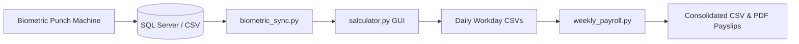

# 🕒 Biometric Payroll & Shift Wage Engine ("Salculator")

An automated end-to-end payroll processing and payslip generator that connects biometric fingerprint attendance hardware logs (eSSL eTimeTrackLite) directly to custom hourly wage rules, loading surcharge pools, and compiled PDF payslips.

---

## 💡 The Problem
In multi-shift retail and warehouse environments, employees work variable hours, and heavy-loading workers split ad-hoc loading fees on top of standard hourly wages. Manually calculating daily hours from biometric logs, dividing loading fees, tracking mid-week advance deductions, and hand-writing physical payslips wastes hours every week and invites accounting errors.

## ⚡ The Solution
1. **Automated Biometric Ingestion**: Directly syncs with biometric attendance databases or daily punch CSV logs.
2. **Dynamic Shift & Wage Calculation**: Computes exact fractional hours and applies tailored hourly pay rates.
3. **Automated Surcharge Division**: Calculates 50% split loading charge distributions strictly among loaders on duty.
4. **Automated PDF Payslip Generation**: Consolidates 6-day work weeks, accounts for cash advances, and outputs ready-to-print formatted PDF payslips.

---

## 🛠️ Architecture



---

## 🚀 Quickstart

### 1. Installation
```bash
pip install -r requirements.txt
```

### 2. Configuration
Copy `.env.example` to `.env`:
```ini
USE_MOCK_DATA=true
EXPORT_DIRECTORY=./exports
```

### 3. Launch Daily Payroll UI
```bash
python salculator.py
```

### 4. Compile Weekly Summary & Payslips
```bash
python weekly_payroll.py
```
Outputs will be generated in `./exports/payslips_compiled.pdf`.
