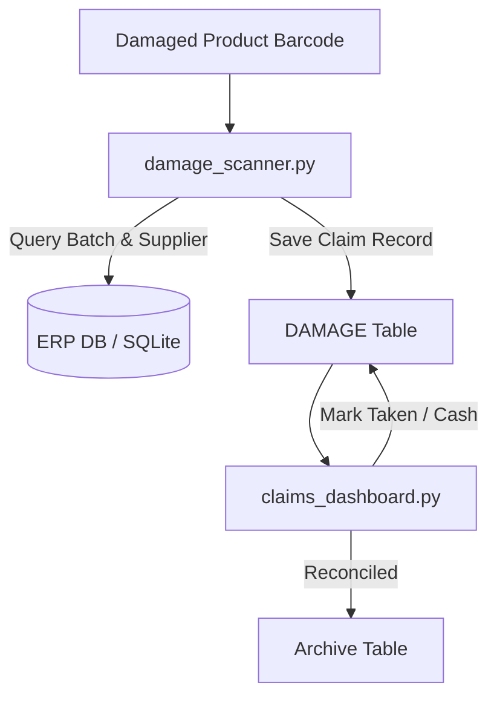

# 📦 Retail Damage Goods & Supplier Return Claims Portal

A barcode-driven retail returns system that streamlines defect logging, vendor attribution, and claim settlement reconciliation against POS/ERP inventory databases.

---

## 💡 The Problem
In grocery, FMCG, and supermarket retail, damaged products constantly pile up at returns desks. Store associates rarely know which distributor or supplier rep delivered a particular batch. Reconciling physical stock with vendor credit notes (cash refunds or replacement items) results in lost revenue from uncollected supplier credits.

## ⚡ The Solution
1. **Barcode-Driven Lookup**: Instant lookup against ERP batch tables (`ProductBatches`, `Parties`) to automatically identify product name and supplying vendor.
2. **Sequential Claim Tracking**: Maintains audit-ready sequential serial identifiers (`SLNO`).
3. **Vendor Claims Dashboard**: Filterable UI enabling warehouse managers to sort claims by supplier when the sales representative visits.
4. **Dual Settlement Status**: Independently tracks:
   - `TAKEN`: Physical merchandise handed back to vendor.
   - `CASH`: Financial credit note or replacement value verified.
5. **Auto-Purge & Archiving**: Safely purges reconciled items once both conditions are met.

---

## 🛠️ Architecture



---

## 🚀 Quickstart

### 1. Installation
```bash
pip install -r requirements.txt
```

### 2. Configuration
By default, the project runs locally using SQLite (`damage_portal.db`) with zero setup!  
To connect to live MS SQL Server, configure `.env`:
```ini
DB_ENGINE=sqlite
# or
DB_ENGINE=sqlserver
SQL_SERVER_HOST=localhost
SQL_SERVER_DB=DAMAGE
```

### 3. Log Damaged Inventory
```bash
python damage_scanner.py
```
*(Try sample barcode: `8901058852395`)*

### 4. Manage & Settle Claims
```bash
python claims_dashboard.py
```
