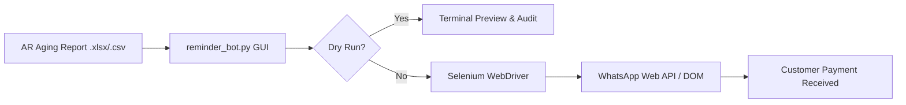

# 💬 WhatsApp Accounts Receivable & Payment Reminder RPA Bot

A Robotic Process Automation (RPA) bot that automates outstanding customer balance notifications using Selenium WebDriver, CustomTkinter, and automated remittance instructions.

---

## 💡 The Problem
Small-to-medium retail and wholesale businesses struggle with cash flow because collecting outstanding debt requires tedious manual calling or copy-pasting ledger balances into messaging apps. Delayed reminders result in mounting aged debtor days.

## ⚡ The Solution
1. **Spreadsheet Ingestion**: Automatically reads Accounts Receivable aging reports exported from ERPs (`.csv`, `.xlsx`).
2. **Dynamic Balance Formatting**: Personalizes each message with debtor name, outstanding dues amount, and company wire transfer instructions.
3. **Automated WhatsApp Web Dispatching**: Drives Google Chrome via Selenium to navigate to each customer's chat and post formatted payment reminders.
4. **Anti-Detection Rate Limiting**: Employs configurable inter-message delays to prevent automated spam detection.
5. **Dry Run Testing Mode**: Allows auditing the personalized notifications in the terminal before sending live messages.

---

## 🛠️ Architecture



---

## 🚀 Quickstart

### 1. Installation
```bash
pip install -r requirements.txt
```

### 2. Configuration
Copy `.env.example` to `.env` and fill in your company remittance details:
```ini
COMPANY_NAME="Acme Retail & Wholesale"
BANK_ACCOUNT_NAME="Acme Store"
BANK_ACCOUNT_NUMBER="123456789"
BANK_IFSC_OR_ROUTING="ROUT001"
```

### 3. Run the Bot
```bash
python reminder_bot.py
```
*Tip: Keep "Dry Run Mode" checked to test your customer messages without launching a live browser session!*
