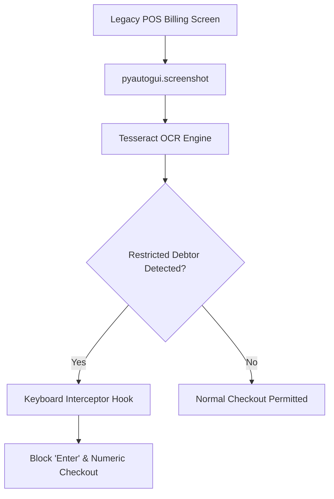

# 🛡️ Real-Time POS Credit Control & OCR Fraud Prevention Bot

A computer vision guardrail bot for legacy Point-of-Sale (POS) systems that continuously monitors checkout screens using Tesseract OCR, detects restricted/overdue credit customers in real time, and intercepts keyboard checkout confirmation to prevent unauthorized credit invoicing.

---

## 💡 The Problem
In legacy desktop ERPs and retail POS software without programmable API hooks, restricting sales to customers with overdue balances is notoriously difficult. Cashiers often override verbal instructions or fail to check credit limits before printing invoices, resulting in massive bad debts.

## ⚡ The Solution
1. **Zero-API Integration**: Does not require modifying legacy POS source code.
2. **Optical Character Recognition (OCR)**: Periodically takes screen captures of active billing modals and scans for debtor names via Tesseract OCR.
3. **OS-Level Keyboard Hooking**: Upon detecting an overdue debtor, temporarily hooks and blocks confirmation keystrokes (`Enter`, numeric keypad), requiring supervisor approval (`Ctrl + Shift + Q`) to unlock.

---

## 🛠️ Architecture



---

## 🚀 Quickstart

### 1. Prerequisites
Install Tesseract-OCR on your machine (e.g. `winget install UB-Mannheim.TesseractOCR`).

### 2. Installation
```bash
pip install -r requirements.txt
```

### 3. Run Simulation Test
```bash
python mock_test.py
```

### 4. Run Live Monitor
```bash
python credit_guard_ocr.py
```
*(Press `Ctrl + Shift + Q` to release checkout lock or `Ctrl + C` in the console to terminate).*
