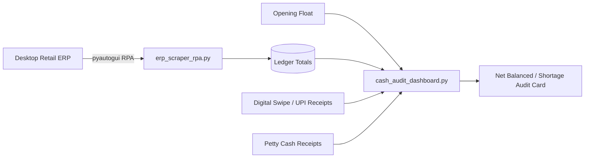

# 💵 End-of-Day Cash Drawer Balancing & ERP Reconciliation Suite

A financial operations utility that connects automated Robotic Process Automation (RPA) ledger scraping with an interactive CustomTkinter balancing dashboard to eliminate cashier shift discrepancy errors.

---

## 💡 The Problem
In multi-counter supermarkets and department stores, balancing daily physical cash drawers against multiple sales channels (cash, digital UPI, credit/debit card swipe machines, and petty expenses) is error-prone. Legacy ERPs lack real-time digital payment consolidation, leading to lengthy manual end-of-day tallying.

## ⚡ The Solution
1. **Desktop ERP RPA Automation**: Automates extraction of daily shift ledger balances across counters 1 through 5.
2. **Interactive Reconciliation Dashboard**: Aggregates opening balances, counter totals, digital payment receipts (UPI/GPay, Card POS), and petty cash expenses.
3. **Live Discrepancy Auditing**: Dynamically displays real-time variance calculations, instantly alerting management to drawer shortages or surpluses with color-coded threshold cards.

---

## 🛠️ Architecture



---

## 🚀 Quickstart

### 1. Installation
```bash
pip install -r requirements.txt
```

### 2. Launch Dashboard
```bash
python cash_audit_dashboard.py
```
*(Modify opening balances or counter figures to view real-time discrepancy updates!)*
