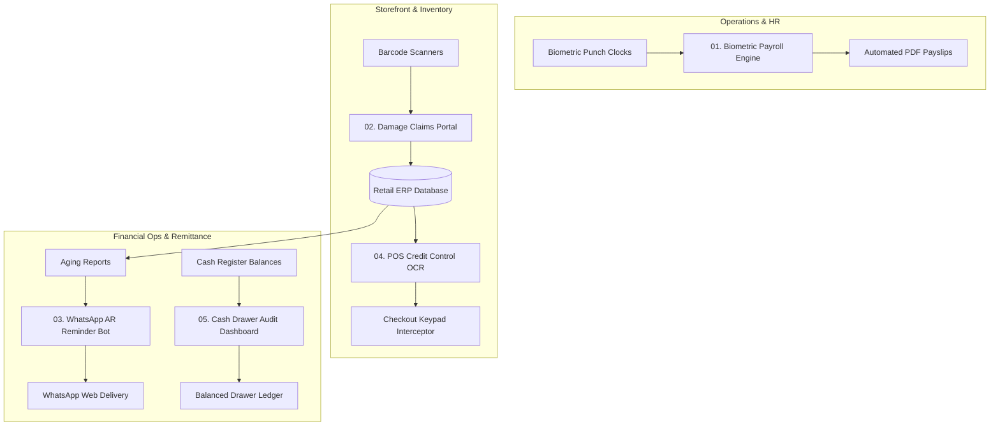

# 🏬 Retail & Enterprise Business Automation Suite

[](https://www.python.org/)
[](https://opensource.org/licenses/MIT)
[](https://github.com/TomSchimansky/CustomTkinter)
[](https://selenium.dev)
[](https://github.com/tesseract-ocr/tesseract)

A comprehensive, production-grade collection of **enterprise business automation tools, Robotic Process Automation (RPA) bots, and modern graphical utilities** built to solve operational bottlenecks across retail store management, inventory control, payroll processing, and financial debt collection.

---

## 🌟 Suite Modules & Overview

```
retail-business-automation-suite/
├── 01-biometric-payroll-engine/       # Biometric shift hours to PDF payslips
├── 02-retail-damage-claims-portal/    # Barcode returns & supplier claim settlement
├── 03-whatsapp-accounts-receivable/   # Automated debt reminders with QR remittance
├── 04-pos-credit-control-ocr/         # Tesseract OCR screen guard for billing limits
└── 05-cash-drawer-reconciliation/     # End-of-day register balancing & RPA audits
```

---

### 1. 🕒 [Biometric Payroll & Wage Calculation Engine](./01-biometric-payroll-engine)
* **Tech Stack**: `Python`, `CustomTkinter`, `FPDF2`, `MS SQL Server (eSSL eTimeTrackLite)`, `Pandas`
* **Features**:
  * Direct ingestion of fingerprint punch logs from biometric machine databases.
  * Dynamically computes fractional hourly pay, overtime, and loading surcharge splits.
  * Consolidates weekly work schedules, handles mid-week cash advances, and outputs ready-to-print branded PDF payslips.

### 2. 📦 [Retail Damaged Goods & Return Claims Portal](./02-retail-damage-claims-portal)
* **Tech Stack**: `CustomTkinter`, `ttk.Treeview`, `SQLite / MS SQL Server`, `Barcode Scanners`
* **Features**:
  * Point-and-shoot barcode scanning that automatically queries ERP batch databases to resolve supplier and item info.
  * Interactive vendor reconciliation dashboard: sorts defects by supplier when reps visit.
  * Independent dual-status tracking (`TAKEN` vs `CASH`) with automated archiving of reconciled inventory.

### 3. 💬 [WhatsApp Accounts Receivable & Dues Reminder RPA Bot](./03-whatsapp-accounts-receivable-bot)
* **Tech Stack**: `Selenium WebDriver`, `ChromeDriverManager`, `CustomTkinter`, `Pandas`
* **Features**:
  * Ingests Accounts Receivable (AR) aging spreadsheets (`.csv`, `.xlsx`).
  * Formats personalized remittance messages with overdue debt figures, bank details, and QR codes.
  * Drives WhatsApp Web via Selenium with built-in human rate-limiting to prevent spam detection.
  * Built-in **Dry Run Mode** for zero-risk message audits before sending.

### 4. 🛡️ [Real-Time POS Credit Control & OCR Guard](./04-pos-credit-control-ocr)
* **Tech Stack**: `Tesseract OCR`, `PyAutoGUI`, `Keyboard Hooking`, `PyGetWindow`
* **Features**:
  * Adds smart credit guardrails to legacy Point-of-Sale systems without modifying POS source code.
  * Continuously scans billing windows via OCR for blacklisted/overdue debtor names.
  * Automatically intercepts confirmation keystrokes (`Enter`, keypad) until authorized by supervisor hotkey.

### 5. 💵 [End-of-Day Cash Drawer Balancing Dashboard](./05-cash-drawer-reconciliation)
* **Tech Stack**: `CustomTkinter`, `PyAutoGUI RPA`, `Python-Dotenv`
* **Features**:
  * Reconciles opening register floats across 5 retail cashier counters.
  * Matches physical cash against digital settlement receipts (UPI, Credit/Debit card slips, petty expenses).
  * Color-coded dynamic variance card alerting management instantly to drawer shortages or surpluses.

---

## 🏗️ High-Level System Architecture



---

## ⚡ Quickstart & Installation

### 1. Clone the Repository
```bash
git clone https://github.com/N0-DE/retail-business-automation-suite.git
cd retail-business-automation-suite
```

### 2. Run Any Module
Each module is self-contained with its own dependencies and zero-setup standalone fallback:
```bash
# Example: Launch Damage Claims Portal
cd 02-retail-damage-claims-portal
pip install -r requirements.txt
python claims_dashboard.py
```

```bash
# Example: Launch WhatsApp Dues Reminder Bot
cd 03-whatsapp-accounts-receivable-bot
pip install -r requirements.txt
python reminder_bot.py
```

---

## 🔒 Security & Privacy Notice
All source code, sample datasets, bank routing numbers, and API credentials in this public repository have been **fully sanitized and decoupled**. Connection parameters are securely loaded via `.env` configuration files.

---

## 👨‍💻 Author
**Jose Anoob** — [GitHub Profile (@N0-DE)](https://github.com/N0-DE)  
*Specializing in Business Process Automation, Desktop RPA, Enterprise Database Integration, and Applied Computer Vision.*
